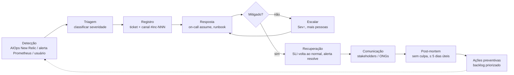

# ITSM — Gestão de Incidentes da SolidaryTech

## 1. Ciclo de vida de um incidente



Versão em imagem para o relatório: exportar este diagrama do Mermaid Live Editor ou do preview do GitHub.

## 2. Fases

| Fase | O que acontece | Ferramenta | Meta de tempo |
|---|---|---|---|
| **1. Detecção** | Anomalia detectada pelo New Relic Applied Intelligence (antes do limiar) ou alerta de burn rate do Prometheus/Alertmanager, ou relato de usuário | New Relic AI, Alertmanager | contínua |
| **2. Triagem** | On-call classifica Sev-1..4 pela matriz abaixo | New Relic Issues / Grafana | ≤ 5 min |
| **3. Registro** | Abre incidente (New Relic Incident / ticket) e canal de guerra | New Relic, Discord/Slack | ≤ 5 min |
| **4. Resposta** | Segue runbook; usa trace distribuído e Loki para achar a causa | New Relic APM, Grafana, Loki, ArgoCD | Sev-1: mitigar ≤ 30 min |
| **5. Escalonamento** | Sem mitigação no prazo → sobe severidade e chama líder | New Relic escalation policy | automático |
| **6. Recuperação** | SLI 5m volta acima do SLO; alerta resolve; monitorar 30 min | Dashboard SRE | |
| **7. Comunicação** | Status para diretoria e ONGs (início, a cada 30 min em Sev-1, encerramento) | e-mail / status page | |
| **8. Post-mortem** | Documento sem culpa: linha do tempo, causa raiz, impacto no error budget, ações | git (`docs/postmortems/`) | ≤ 5 dias úteis |
| **9. Melhoria** | Ações viram itens no backlog com dono e prazo | GitHub Issues | |

## 3. Matriz de severidade

| Sev | Critério | Exemplos | Resposta | Comunicação |
|---|---|---|---|---|
| **1** | Doações paradas ou dados em risco | `DonationServiceDown`, RDS inacessível, burn rate 14× | página on-call imediatamente; líder em 15 min | ONGs em 30 min |
| **2** | Degradação relevante do hot path | burn rate 6×, latência acima do SLO | página on-call | diretoria em 1 h |
| **3** | Serviço secundário afetado | ngo/volunteer com erro | ticket, próximo dia útil | interna |
| **4** | Sem impacto ao usuário | alerta de disco, budget 50 % | ticket | interna |

## 4. Runbooks

### runbook-donation-5xx
1. Abrir New Relic → APM → `solidarytech-donation-service` → Errors: qual span falha (Postgres? SQS?).
2. Loki: `{namespace="solidarytech", container="donation-service"} |= "Erro"`.
3. Se banco: o erro no trace/Loki diz a causa. `relation "donations" does not exist` = schema alterado (migração/DDL
   quebrada): desfazer a mudança no banco. No teste de caos isso é `scripts/06-sre-chaos.sh restore`; a tabela não
   está no git, então o ArgoCD não corrige. Erro de conexão/autenticação: `kubectl -n solidarytech get pods`,
   status do RDS no console, `db-credentials` correto?
4. Se deploy recente: `git revert <sha>` na main → ArgoCD faz rollback em ~1 min. Alternativa imediata: `kubectl -n argocd` → history & rollback pela UI.
5. Se SQS: doações continuam (POST retorna 201 mesmo com fila fora; log `Falha ao despachar evento SQS`), mas o envio
   é feito antes da resposta e cada POST espera até o timeout de 2 s: a latência sobe (ver runbook-donation-latencia).
   Verificar a fila e a DLQ.

### runbook-donation-latencia
1. Dashboard SRE → painel Saturação: CPU perto do request? HPA no máximo? → subir `maxReplicas` no overlay.
2. New Relic → Databases: query lenta? índice `donations_ngo_id_idx` existe?
3. Nós saturados (`kubectl top nodes`) → aumentar `node_max` no Terraform.

### runbook-rds-restore
1. `aws rds restore-db-instance-to-point-in-time` para o momento anterior ao dano (RPO 5 min).
2. Atualizar os parâmetros SSM `/solidarytech-primary/*/database_url` com o novo endpoint.
3. Re-executar o trecho "Secret db-credentials" do `04-bootstrap-cluster.sh` e `kubectl rollout restart`.

## 5. Template de comunicação (Sev-1)

> **[SolidaryTech] Incidente em andamento — Sev-1**
> Desde HH:MM estamos com falha no registro de doações. Impacto: doações não estão sendo confirmadas.
> Causa provável: … Ação em curso: … Próxima atualização em 30 min.
> — Time de Plataforma

## 6. Template de post-mortem

```
# PM-AAAA-MM-DD — <título>
Impacto: duração, usuários/ONGs afetadas, error budget consumido (%)
Linha do tempo (UTC-3): detecção → triagem → mitigação → recuperação
Causa raiz (5 porquês)
O que funcionou / o que não funcionou
Ações: [ ] item — dono — prazo
```
